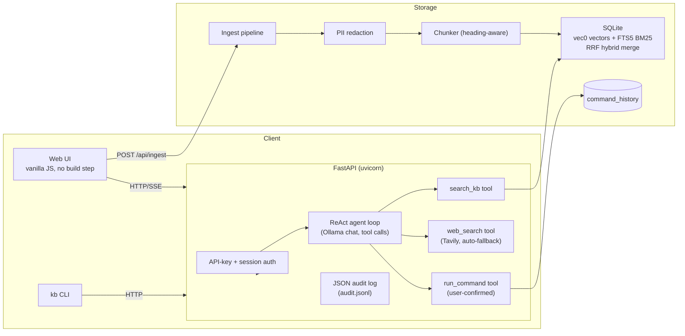

# itkb — Local LLM IT Knowledge Base

Your personal IT support system. Feed it runbooks, notes, PDFs, and wiki pages.
Ask questions naturally. It searches your documents and answers with citations.

Everything runs locally — Ollama for LLM, SQLite for storage, your browser for UI.

## Quick Start

```bash
# 1. Install
cd ~/itkb
pip install -e .

# 2. Make sure Ollama has the models you set in PROGRAM.md
ollama list

# 3. Add some knowledge
kb add ~/notes/runbooks.md
kb add --url https://wiki.example.com/nginx-troubleshooting

# 4. Ask a question
kb query "how do I rotate SSL certificates?"

# 5. Open web UI
kb serve
# → http://localhost:8000
```

## Run with Docker

Prereq: Docker Desktop (or Docker Engine + compose plugin).

```bash
# API container + your host's Ollama (keeps GPU + your models)
docker compose --profile host-ollama up

# Self-contained demo: bundled Ollama + llama3.2:3b + sample corpus (~2.3GB first pull)
docker compose --profile bundled --profile demo-data up
```

Then open http://localhost:8000. The `host-ollama` and `bundled` profiles are
mutually exclusive (both bind host port 8000) — run only one at a time.

Config precedence: env vars (`ITKB_MODEL`, `ITKB_EMBED_MODEL`,
`ITKB_PROGRAM_PATH`, `OLLAMA_HOST`) > `config.toml` (created with defaults on
first boot). The bundled profile sets the small models via env vars; for the
host-Ollama profile, set `ITKB_MODEL`/`ITKB_EMBED_MODEL` or edit the config
volume. `PROGRAM.md` is mounted read-only into the container for governance.

Data persists in the `itkb-data` volume. Full reset:

```bash
docker compose down -v
```

Note: on Linux, `host.docker.internal` is wired via `extra_hosts` in the
compose file; on macOS/Windows it works out of the box.

## Central Control — PROGRAM.md

**Every operation requires approval through PROGRAM.md.** This file is the single
source of truth for what itkb can do. Edit it, save it, and the agent enforces it
on the next query.

```yaml
# PROGRAM.md — what you control:

## Models                  # which Ollama models to use
chat: gemma4:latest
embed: embeddinggemma:latest

## Path Whitelist          # only these directories can be ingested
- /Users/bila/notes/
- /tmp/

## URL Whitelist           # only these URL prefixes can be scraped
- https://wiki.
- https://docs.

## Command Execution       # OFF by default — you must explicitly enable
commands_enabled: false    # set to true when you're ready

## Query Behavior
top_k: 5                   # how many chunks to retrieve per search
trusted: false             # if true, commands run without confirmation prompt
```

### Safety model

| Setting | Default | What it does |
|---------|---------|-------------|
| `commands_enabled` | `false` | Blocks ALL shell commands until you explicitly approve |
| Path whitelist | empty | Only listed directories can be ingested |
| URL whitelist | empty | Only listed URL prefixes can be scraped |
| Blocked patterns | permanent | `rm -rf`, `dd if=`, `mkfs`, `shutdown`, `reboot`, fork bombs — never allowed |
| Confirmation prompt | per-command | Even when enabled, YOU must type `y` for each command |

**To enable commands:** open `PROGRAM.md`, change `commands_enabled: false` to
`commands_enabled: true`, save. That's your explicit approval.

## Commands

```
kb add <path>              # Ingest a file or directory
kb add --url <url>         # Ingest a web page
kb add --watch <dir>       # Watch a directory for changes

kb query "question"        # Ask a question (streaming answer)
kb query -k 10 "q"         # Return more search results

kb list                    # Show all ingested documents
kb delete <doc-id>         # Remove a document

kb serve                   # Start web UI at http://localhost:8000
kb serve --port 3000       # Custom port

kb models                  # List available Ollama models
kb config show             # Show current config
kb config set model llama3.1:8b  # Switch chat model
kb config set embed_model nomic-embed-text  # Switch embedding model

kb reindex                 # Re-embed all docs (after switching embed model)
```

## Web UI

```
http://localhost:8000/          Chat — ask questions, see streaming answers
http://localhost:8000/docs-ui   Documents — add, list, delete knowledge
http://localhost:8000/history   History — command execution log
```

## Architecture



## Design decisions & trade-offs

**Why SQLite (vec0 + FTS5) over Chroma/Qdrant/pgvector?** itkb is a
single-user, local-first tool. SQLite gives the entire knowledge base — vector
index, BM25 full-text index, and relational tables — in one portable file with
zero extra services to run or back up. Chroma is fine for demos but adds a
process; Qdrant/Weaviate solve distributed scale itkb will never need;
pgvector would force a Postgres install. The honest trade-off: SQLite won't
scale past a few hundred thousand chunks, which is far beyond a personal KB.

**Why hybrid BM25 + vector retrieval?** Pure vector search blurs exact terms
that IT runbooks are full of — error codes, package names, flags. Pure lexical
(FTS5/BM25) misses paraphrases. itkb runs both and merges by Reciprocal Rank
Fusion (RRF), combining rank positions rather than raw scores, which sidesteps
the fact that vector distance and BM25 scores live on incompatible scales.
The cost: two searches per query. RRF scores are rank-based, so there is no
meaningful "relevance threshold" — that's why the Tavily web fallback triggers
on *zero* results, not on a score cutoff.

**Why Ollama for everything?** Models run locally, so documents never leave
the machine, answers work offline, and there are no per-token API costs. The
embedding model also runs through Ollama rather than sentence-transformers —
that keeps the Python dependency tree small (no torch) and the Docker image
~300MB instead of multiple GB.

**Why a custom chunker instead of LangChain?** The chunker tracks markdown
heading breadcrumbs (so a chunk about `Docker > Networking` carries that full
context) and skips heading detection inside fenced code blocks. Chunk size is
512 tokens with 64 overlap — big enough to hold a coherent procedure, small
enough to keep retrieval precise and embedding cheap. LangChain's
RecursiveCharacterTextSplitter is a fine default but doesn't give heading
context, and the custom path is ~100 lines with no framework lock-in. Same
reasoning for the hand-rolled agent loop over LangChain's AgentExecutor.

**Why FastAPI?** Async SSE streaming for the chat responses, pydantic request
models, dependency-injection auth, and first-class OpenAPI docs — all without
a heavyweight framework. Flask would need extensions for most of this; Django
is overkill for a personal tool.

**Why plain HTML + vanilla JS?** No build step, no node_modules, no CDN. The
UI is four static templates served straight from disk — consistent with the
local-first, offline goal. The trade-off is real: hand-rolled DOM updates and
no component reuse, which is fine at this surface area.

**Security posture (denied by default).** The web API requires an API key
(`X-API-Key` header) or a session cookie for every `/api/*` call; the key is
auto-generated on first boot. Sessions are stateless HMAC-signed cookies that
expire in 30 days and never embed the raw key. Ingestion scrubs true PII
(emails, phones, SSNs, credit cards — Luhn-validated) with type-specific
markers, deliberately *not* touching IPs/hostnames/tokens, which are
legitimate runbook content. Every query, login, ingest, delete, and command
appends a structured line to `audit.jsonl`. The blast radius is capped at
"whoever is on this machine" — there is no TLS or multi-user RBAC, which is a
conscious scope limit for a single-user localhost tool.

**Why PROGRAM.md as the control plane?** Instead of scattering policy across
flags, one markdown file at the repo root is the single source of truth:
which models, which paths/URLs may be ingested, whether commands may run.
Edit the file, restart, behavior changes. It's auditable by construction and
gets mounted read-only into the container so the governance story holds in
Docker too.

**Latency observations.** First query after boot pays model load time (Ollama
keeps the model warm after that). Retrieval is sub-second for a personal KB
(hundreds of chunks). Token generation dominates: a 30B local model streams
~10-30 tokens/sec on consumer hardware, so answers arrive as a stream rather
than a wait-then-dump. Use a small model (llama3.2:3b, as the bundled Docker
profile does) if latency matters more than answer depth.

**What's deliberately not done.** No TLS, rate limiting, or multi-user RBAC
(single-user localhost tool). PII redaction is regex-based, not NER — a
deterministic, dependency-free trade-off. The audit log is plain JSONL, not
hash-chained. No retroactive redaction of already-stored chunks — re-ingest
to scrub.

## Files

```
~/.itkb/config.toml     Runtime config (auto-synced from PROGRAM.md)
~/.itkb/kb.sqlite       Your knowledge base (single file)
~/.itkb/audit.jsonl     Structured JSON audit log (append-only)
~/itkb/PROGRAM.md       Central control — edit this to change behavior
```

## Tests

```bash
pytest -v                # 132 unit tests (no Ollama needed)
```
